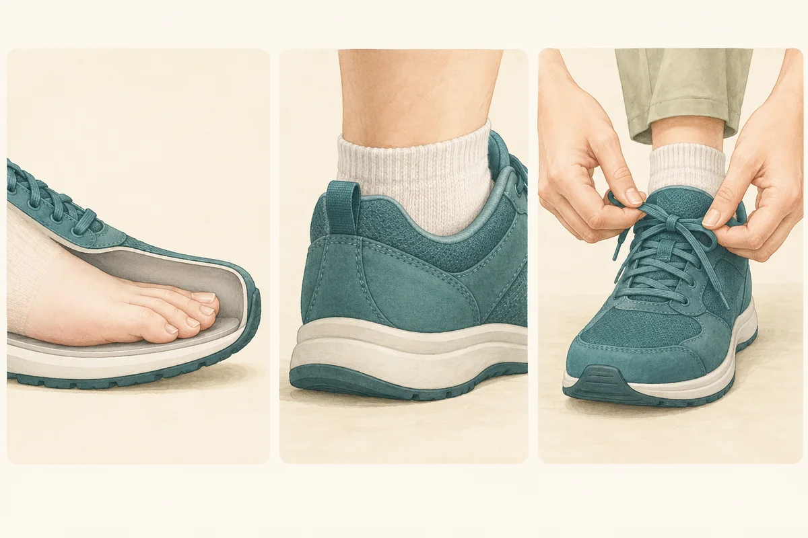
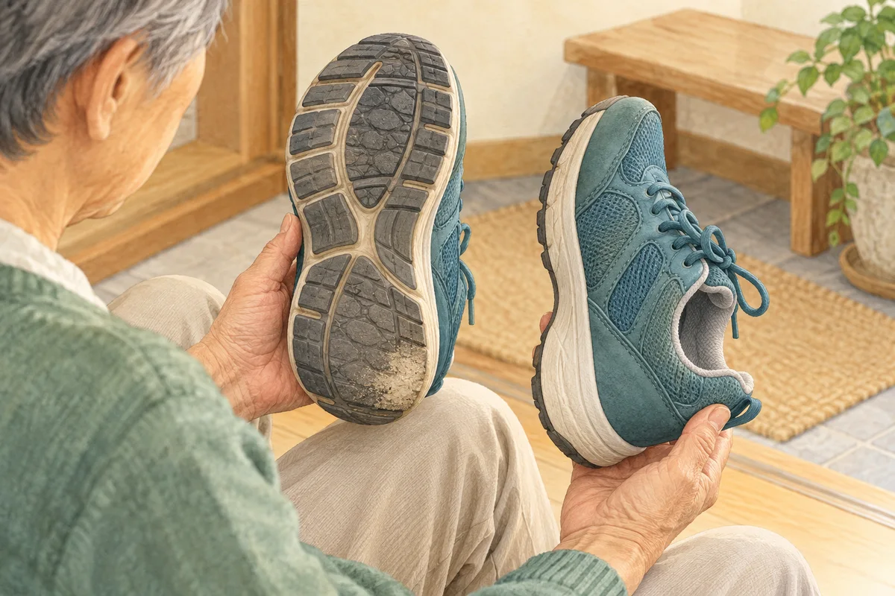
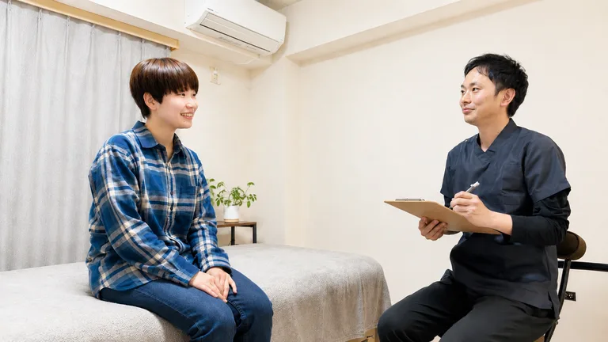

# 膝が痛いときの靴選び｜買い替える前に確認したいこと
- slug: knee-pain-shoe-fit
- date: 2026-10-21
- updated: 2026-10-21
- category: knee-pain
- region: 柏市
- status: publish
- description: 膝が痛いと、クッションの厚い靴やインソールに替えた方がよいか迷います。柏市の整体院ひざこぞうが、つま先の余裕、かかとの収まり、靴底の状態を確認するポイントと、受診を優先したい症状を整理します。買い替える前に、今の靴と歩く場面を一緒に見直しましょう。
- tags: 膝の痛み / 靴選び / ウォーキング / インソール
- symptoms: 膝の痛み / 変形性膝関節症
散歩の途中で膝が気になり、「もっと柔らかい靴にすれば楽になるかな」と考える。靴屋さんで履いたときはよかったのに、買い物で歩くと何だか合わない。そんな経験はありませんか。

膝が痛いときの靴選びは、クッションの厚さや値段だけでは決められません。まずは、足に合っているか、歩くと靴の中で足がずれないか、どの場面で膝がつらくなるかを整理してみましょう。
## 買い替える前に、今の靴を確かめましょう
靴を見直すことは、日常の歩きやすさを考える一つの方法です。ただし、靴だけで膝の痛みの原因が分かるわけでも、靴を替えれば改善するわけでもありません。
いつも履く一足で、足指が当たる、かかとが浮く、靴ひもを緩めたまま歩いている、といったことがないか確認してください。新しく買う前に、履き方やサイズの問題に気づく場合もあります。
「外出すると痛い」というときは、靴以外の条件も一緒に見ます。普段より長く歩いた、重い荷物を持った、階段が多かったなど、その日に違っていたことも大切な手がかりです。

## 靴選びより先に受診したい症状
急な強い痛み、膝の大きな腫れや変形、体重をかけられない状態、膝を動かせない状態では、靴の調整だけで様子を見ないでください。発熱を伴って膝が赤く熱を持つ場合も、早急に医療機関へ相談する目安です。
数週間たってもよくならない痛みや、普段の移動が難しくなっている場合も、まず整形外科などで状態を確認しましょう。

## 試し履きで見たい3つのこと

### つま先に余裕があり、幅も窮屈でないか
足指が先端や横に押しつけられていないかを確かめます。長さだけ大きくしても、かかとが抜けるようでは足に合っているとはいえません。左右とも履き、普段使う靴下で確認してください。
「履いているうちに伸びるだろう」と、痛いところを我慢して選ぶ必要はありません。足指を少し動かせるか、甲や指の付け根に強く当たる場所がないかも見ます。

### かかとが収まり、ひもやベルトで調整できるか
立って数歩歩き、かかとが繰り返し浮かないか、足が前へずれないかを確かめましょう。ひもやベルトは、足を締めつけすぎずに靴を留めるためのものです。履き口を広げたまま使わず、その都度調整します。

### 靴底が滑りにくく、不安なく歩けるか
店内で足踏みするだけでなく、可能なら少し歩いて向きも変えてみます。足元がぐらつく、指先で踏ん張らないと靴が脱げそう、と感じるものは避けましょう。
これらは、足に合う靴を選ぶための一般的な確認ポイントです。膝の病気を診断したり、施術効果を判定したりするチェックではありません。

## クッションが柔らかければよい、とは限りません
柔らかさを心地よく感じる方もいますが、沈み込みや足元の不安定さが気になる方もいます。反対に、硬い靴底を選べば誰でも膝が楽になる、ということでもありません。
2024年の研究では、膝の内側に変形性関節症がある方に、運動療法と、柔軟な靴または安定性のある靴を組み合わせて比較しました。主な評価時点では、歩くときの膝痛の変化に、両群の有意な差は認められませんでした。
特定の病態と運動療法の組み合わせを調べた研究なので、すべての膝痛や市販の靴に当てはめることはできません。「このタイプなら間違いない」と決めず、自分の足に合うかと、実際に歩いたときの感じ方を確かめることが大切です。

## 靴底の減り方だけで、膝の原因を決めないでください
今の靴を持ち上げて、底の溝がなくなっていないか、左右で傷み方が大きく違わないか、かかとがつぶれていないかも見てみましょう。傷みが強い場合は、靴店などで買い替えの相談をする材料になります。
ただし、「外側が減っているからO脚」「この減り方が膝痛の原因」とは決められません。使った期間、地面、靴の素材なども違います。気になった状態を写真に残しておくと、相談するときに説明しやすくなります。

## インソールは、必要かどうかを相談してから
膝が痛い方全員に、インソールが必要なわけではありません。靴の中で足が収まるか、使う目的に合っているかを確認し、必要に応じて医療機関で相談しましょう。
自己判断で何枚も重ねると靴の中が狭くなり、足指や甲に当たることがあります。使っている方は、インソールを入れた状態での収まりも確認してください。医療機関で処方されたものは、変更前に処方元へ相談しましょう。

## 新しい靴は、短い外出から確かめましょう
靴を替えた日に、散歩の距離まで一気に増やす必要はありません。まずは近所への短い外出など、負担を調整しやすい場面で履き、足の当たり方や膝の感じ方を確認します。痛みが増えるなら、慣れるまで我慢するのではなく、使用を控えて相談してください。
相談前には、履いた靴、歩いた場所と時間、痛む場所、歩いた後の変化を簡単にメモしてみましょう。歩く量の調整については、[歩くと膝が気になるときの記事](/blog/posts/knee-walking/)でも説明しています。

## 当院では、靴と普段の動きも一緒に伺います
整体院ひざこぞうでは、どんな靴で、どのくらい歩くとつらくなるのかを伺い、姿勢や歩き方、関節の動きを確認します。気になる靴や靴底の写真があれば、相談のときに見せてください。
施術を行える状態であれば、身体の状態に合わせて施術や運動、日常動作の練習を考えます。靴の傷み方だけで原因を断定したり、特定の靴で改善するとお約束したりはしません。[MSMメソッドの施術案内](/msm.html)もご覧いただけます。

## 参考資料
資料確認：2026年10月31日。一般的な情報であり、個別の診断や、靴・インソールの処方に代わるものではありません。
- [国立国際医療センター：靴の選び方](https://www.hosp.jihs.go.jp/s027/010/040/030/index.html)
- [日本整形外科学会：変形性膝関節症](https://www.joa.or.jp/public/sick/condition/knee_osteoarthritis.html)
- [済生会：化膿性関節炎](https://www.saiseikai.or.jp/medical/disease/pyogenic_arthritis/)
- [運動療法と靴の種類を比較した研究（2024年）](https://academic.oup.com/rheumap/article/8/4/rkae133/7852843)

## よくあるご質問

### 高いウォーキングシューズに替えるべきですか？
値段だけでは決められません。今の靴の傷みや足への収まりを確かめ、試し履きで無理なく歩けるかを見てください。特定の商品で膝痛が改善するという保証はありません。

### 靴の外側が減っていたら、歩き方を直す必要がありますか？
減った場所だけで判断はできません。痛む場面や足の状態、実際の歩き方も合わせて確認します。見た目をそろえようと、無理に足の向きを変えるのは控えましょう。

### 靴を替えても膝が痛い場合はどうしたらよいですか？
靴以外の要因も考える必要があります。痛みが続く場合は整形外科などで状態を確認してください。急な強い腫れや体重をかけられない状態、発熱を伴う赤み・熱感があれば、早急な受診が優先です。
