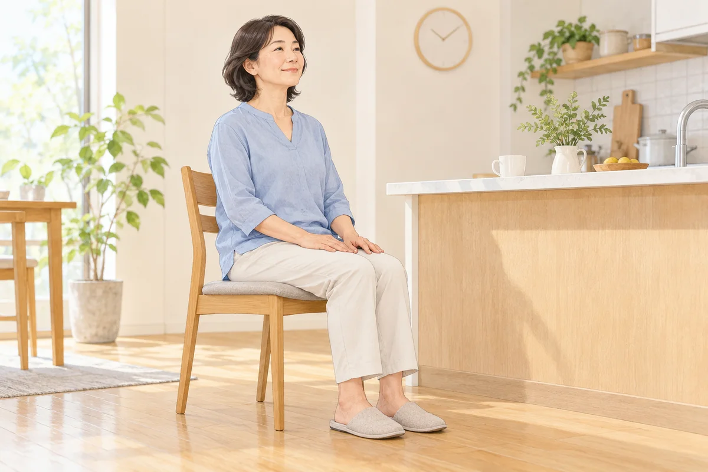
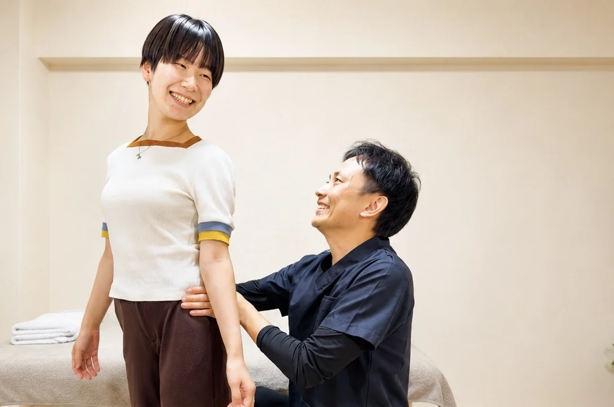

台所で洗い物をしていると、膝の裏やふくらはぎが疲れる。立っているとき、膝を後ろへグッと押し込むように伸ばしている気がする。そんな立ち方に、心当たりはありませんか。

気になるときは、膝の角度だけを直そうとする前に、どんな場面でつらくなるのかを確かめましょう。膝を伸ばしきる姿勢は確認するポイントの一つですが、それだけで痛みの原因が決まるわけではありません。

## 反張膝とは、膝が伸びる方向へ反りすぎている状態です

横から見たとき、膝がまっすぐの位置を越えて、後ろへ反るように伸びている状態を「反張膝」と呼びます。膝の「過伸展」という言葉で説明されることもあります。

ただし、写真を一枚見て「反張膝だから痛い」「この筋肉が弱い」と決めることはできません。もともとの関節の動きやすさや、けがの有無、普段の身体の使い方を分けて考える必要があります。

実際に、痛みのない方も含めて反張膝を調べた研究があります。見た目が気になることと、治療が必要な痛みや不安定さがあることは、同じではないのです。自分で膝を後ろへ押して、どこまで反るか試す必要はありません。

## けがの後から変わった立ち方は、先に整形外科へ

転んだ、膝をひねった、ぶつけた。その後から膝が伸びすぎる感じや、ガクッと抜ける感じが出てきた場合は、立ち癖と考えて済ませず、整形外科で確認してください。

日本整形外科学会も、膝のけがでは痛みの軽さや歩けることだけで、靱帯などの損傷を否定できないと説明しています。

腫れや熱感がある、じっとしていても痛む、痛みが悪化している場合も、自己流の姿勢練習より医療機関での確認を優先しましょう。以前からの立ち方なのか、最近急に変わったのかは、相談するときにも大切な情報になります。

## 「きれいに立つ」を頑張りすぎていませんか？

姿勢を良くしようとして、胸を張り、脚までピンと伸ばす。気づくとその姿勢を保とうと力が入っていることがあります。

まず思い出してほしいのは、洗い物やレジ待ち、仕事中など、つらさが出る場面です。膝を最後まで伸ばしているかだけでなく、片脚に体重を預けていないか、同じ姿勢が長く続いていないかも見てみましょう。

膝の裏やふくらはぎが疲れるとしても、それだけで反張膝が原因とはいえません。「立ち始めは平気だけれど、時間がたつとつらい」「座ると落ち着く」といった変化の方が、身体の状態を相談する手がかりになります。

## 筋力だけでなく、筋肉の働き方も見ていきます

「膝が伸びすぎるなら、太ももを鍛えればいいのかな」と考える方もいると思います。

立ち仕事をする健康な成人を調べた研究では、反張膝の角度と、股関節や膝を動かす筋肉の筋力の比率との関連が報告されています。ただし、筋力のバランスを変えれば反張膝や痛みが改善する、と証明した研究ではありません。

そのため、見た目から特定の筋肉を「ガンバリ筋」「サボり筋」と決めて、全員に同じ筋トレを勧めることはしません。当院ではこの言葉を、頑張りすぎている筋肉と、使いにくい筋肉を説明するために使っています。実際の動きを確認してから、その方に必要な練習を考えます。

## 膝を曲げたまま、頑張って立ち続けなくて大丈夫です

伸ばしすぎを気にして、一日中膝を曲げたまま耐える必要はありません。それで太ももがつらくなるなら、力を入れ続ける方法をいったん見直しましょう。

家で取り入れるなら、まずは立ち続ける時間を区切るところから。洗い物を途中で分ける、座ってできる作業を挟むなど、同じ姿勢を続けない工夫を考えます。痛みを我慢して、立てる時間を延ばす練習にする必要はありません。

ストレッチでも、膝を後ろへ押し込んだり、強く反らせたりして形を変えようとしないでください。けがや手術の後、装具を使っている場合は、立ち方や運動を変える前に担当の医療者へ相談しましょう。

## 当院では、股関節・足首から普段の動きまで確認します

整体院ひざこぞうでは、膝だけの見た目に答えを求めず、姿勢や関節の動き、普段困っている動作を確認します。膝の相談では、股関節の内外への動きや足部の状態なども見ていきます。

MSMメソッドでは、動きを妨げる筋肉を緩める「モビリティ」、使いにくい筋肉を使う練習の「スタビリティ」、しゃがむなどの動作へつなげる「ムーブメント」を、身体の状態に合わせて考えます。緩めるだけで終わらせず、自分の身体を使う練習につなげることを大切にしています。

ただし、反張膝という見た目だけで、全員に同じ順番や運動を当てはめるわけではありません。膝の形が必ず変わるとお約束するのではなく、生活で困っていることを伺い、取り組める内容を一緒に整理します。

## よくある質問

### 膝が後ろに反って見えたら、必ず直すべきですか？

見た目だけでは判断できません。痛みや腫れ、不安定さ、生活で困ることがあるかを一緒に考えます。最近立ち方が変わった場合や、けがの後から気になった場合は、整形外科へ相談してください。

### 太ももの前を鍛えればよいですか？

一つの筋肉だけで決めることはできません。膝や股関節の動き、筋肉の働き、運動中の痛みを確認し、その方に合う内容を選びます。筋トレと運動療法の考え方は、関連する記事でも説明しています。

### 相談するときは何を伝えるとよいですか？

いつから気になるか、どこがつらいか、どんな作業をどのくらい続けると症状が出るかを教えてください。けがや手術、医療機関で受けた説明も、分かる範囲でお伝えいただければ大丈夫です。

## 立ち方が気になるときは、困る場面から相談してください

「反張膝かどうか分からないけれど、長く立つとつらい」。そのような相談でも大丈夫です。姿勢を正しくしようと頑張り続ける前に、今の身体で何が起きているか、一緒に確認しましょう。

[膝の痛みについて](/symptoms/knee-pain.html)、[MSMメソッドの施術案内](/msm.html)、[初回の流れ・料金](/reservation.html)もご覧いただけます。

## 参考資料

- [日本整形外科学会：膝関節捻挫](https://www.joa.or.jp/public/sick/condition/sprain_of_knee.html)
- [運動器の健康・日本協会：ひざ痛セルフケア手帳](https://www.bjd-jp.org/wp-content/uploads/2025/04/knee-pain-selfcare.pdf)
- [Ahnら（2020）：立ち仕事をする成人の反張膝角度と筋力の関連](https://pubmed.ncbi.nlm.nih.gov/32417824/)
- [Kawaharaら（2012）：反張膝と歩行の研究](https://pubmed.ncbi.nlm.nih.gov/22068266/)
