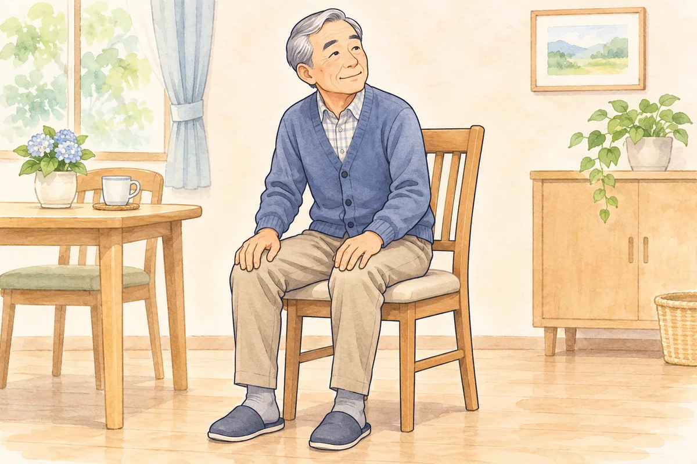
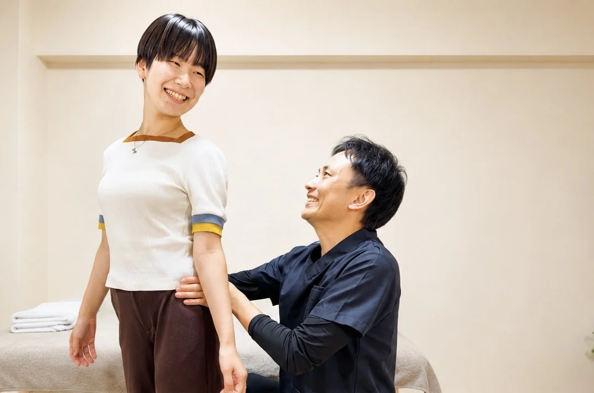
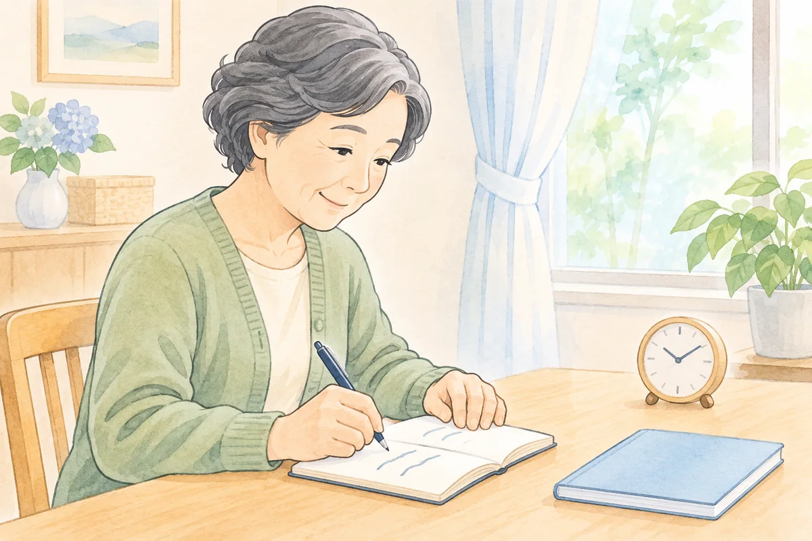

「姿勢を良くしよう」と胸を張ったら、かえって脚がしびれてきた。前かがみの方が楽だけれど、このまま背中が丸くなってしまうのも心配。脊柱管狭窄症と言われ、どう立てばよいのか迷っていませんか。

まずは、つらさを我慢して背筋を伸ばし続けなくて大丈夫です。見た目をまっすぐにすることより、どんな姿勢や動きで症状が変わるのかを確かめ、今の身体に合う過ごし方を考えましょう。

## 胸を張るほど、楽に立てるとは限りません

「胸を張る」「背筋を伸ばす」と聞くと、腰までグッと反らせてしまうことがあります。腰部脊柱管狭窄症では、立つ・歩くと脚がつらくなり、少し前かがみになる、座るといった姿勢で軽くなる場合があります。

そのような方が、痛みやしびれを我慢して反る姿勢を続ける必要はありません。姿勢を変えて脚の症状が増えるなら、その動きはいったんやめ、楽に休める姿勢を選びましょう。

ただし、前かがみで楽になることだけで、脊柱管狭窄症と決まるわけではありません。脚の血流など、別の病気で似た歩きにくさが出る場合もあります。まだ診断を受けていない方は、先に整形外科などで確認してください。

## 脚の力や排尿・排便が急に変わったら、姿勢の練習より受診を

急に脚に力が入りにくくなった、尿が出にくい・漏れる、便をコントロールしにくい、股やお尻のまわりの感覚がいつもと違う。こうした新しい変化が出た場合は、自己流の体操や整体の予約を待たず、速やかに医療機関へ連絡してください。

尿が出ない、脚を動かせないなどの症状では、救急での受診が必要です。「いつもの狭窄症だろう」と様子を見ず、変化が始まった時刻と症状を伝えましょう。歩ける距離が短くなってきた、つまずきが増えた場合も、担当医へ相談してください。

## 前かがみで楽になるのは、姿勢で神経の通り道が変わるためです

脊柱管は、背骨の中にある神経の通り道です。腰部脊柱管狭窄症では、骨や椎間板、靱帯などの変化により、その空間が狭くなって神経に影響が出ます。

前かがみで一時的に空間が広がり、脚の症状が軽くなることがあります。これは「姿勢が悪いから病気になった」「身体を反らせなければ治る」という意味ではありません。

日本整形外科学会の案内でも、前かがみで楽になることを説明する一方、その姿勢を長く続けると腰痛につながる場合があるとしています。楽になる姿勢を休むために使うことと、一日中その形を保ち続けることは分けて考えましょう。

## 腰だけを見ず、身体全体の使い方を確認します

胸を張っているつもりでも、骨盤を前へ押し出し、上半身が後ろに残っている。反対に、膝を曲げて背中を丸めないと立ちにくい。外から見た「姿勢」には、身体のいろいろな部分の動きが表れます。

そこで確認したいのは、写真の形だけではありません。立ち上がるときにどこへ力を入れているか、股関節は動かしやすいか、足元は安定しているか。普段の動きと、そのときの症状を一緒に見ていきます。

見た目から「お腹が弱い」「この筋肉が原因」と決めて、同じ筋トレを足せばよいわけでもありません。胸や腰の位置を意識するだけで力んでしまう方なら、まず楽に動ける範囲を確かめることから始めます。

## 家では、姿勢の形より続ける時間を見直しましょう

洗い物、調理、電車待ちなど、つらさが出る場面を一つ選んでみてください。立ち続ける時間を区切る、座ってできる作業を挟むなど、休みを取りやすい方法を考えます。

「あと少しだから」としびれを我慢して終わらせるより、症状が出る前後の様子を知ることが相談の助けになります。何分立てるかを試すために、限界まで続ける必要はありません。

また、腰を強く反らす、深く丸める、背骨をねじるといった動きを、動画と同じ形になるまで繰り返さないでください。医師やリハビリの担当者から運動を教わっている方は、その目的と動かしてよい範囲を確認しましょう。

## 運動療法は、今できる動きから日常へつなげます

脊柱管狭窄症の治療には、運動などの手術以外の方法と、状態に応じた手術があります。どの治療が必要かは、脚の力や生活への影響、検査の結果などから医師が判断します。

運動療法を考えるときも、「背筋を伸ばせるようになること」だけを目標にしません。食事の支度を休みながら続けたい、近所へ買い物に行きたいなど、生活でできるようになりたいことを共有します。

そのうえで、身体を支える筋肉を使う練習や、関節を動かす練習、立つ・歩くときの使い方を、その方の状態に合わせて選びます。運動で狭窄そのものがなくなると考えず、担当医の説明を踏まえて進めましょう。

## 当院では、腰の反り方と股関節・足元を一緒に見ます

整体院ひざこぞうでは、医療機関で受けた説明や運動の制限を伺い、困っている動作を確認します。立つ・歩く場面での腰の反り方、股関節や足首の動き、筋肉への力の入り方などを見ていきます。

MSMメソッドでは、動きを妨げている筋肉・筋膜への手技、使いにくい筋肉を使う練習、日常動作での使い方を考えます。筋肉を緩めて終わりにせず、自分の身体をどう使うかを一緒に確認することを大切にしています。

整体で狭くなった脊柱管を広げたり、手術が必要かどうかを判断したりすることはできません。医療機関での治療を続けながら、日常の動きで相談したいことを伺います。

## 相談するときは「どう変えると、どうつらいか」を伝えましょう

「姿勢が悪いと言われました」から、もう少し具体的にしてみましょう。「調理中に胸を張ると、右のふくらはぎがしびれる」「椅子に座って休むと落ち着く」など、いつもの生活で起きたことを教えてください。

立っていた時間、症状が出た場所、休み方を短くメモしておくと伝えやすくなります。薬やリハビリなどの治療内容、担当医から受けた説明も、分かる範囲でお持ちください。

## よくある質問

### 前かがみで楽なら、ずっと丸まっていた方がよいですか？

楽になる姿勢を休憩に使うことはありますが、同じ形を長く保ち続けることを勧めるものではありません。つらさが出る時間や動作を確認し、過ごし方を担当の医療者と相談しましょう。

### 姿勢を整えれば、しびれはなくなりますか？

姿勢だけで決まるものではなく、しびれがなくなるとはお約束できません。見た目の変化だけで判断せず、脚の力や歩きやすさ、生活への影響も含めて確認します。

### 病院で治療中でも相談できますか？

ご相談いただけます。診断内容や運動制限を伺い、当院でお手伝いできる範囲を確認します。手術の必要性や薬の変更については、担当医にご相談ください。

## 「まっすぐにしなきゃ」と頑張る前に

姿勢の見た目が気になると、身体が出しているつらさより、「良い形」を優先してしまうことがあります。まずは、無理なく過ごせる場面と困る場面を整理するところから始めましょう。

[脊柱管狭窄症について](/symptoms/spinal-stenosis.html)と、[歩くと脚がしびれるときの記事](/blog/posts/lumbar-spinal-stenosis-walking/)もご覧いただけます。相談を考えている方は、[初回の流れ・料金](/reservation.html)でご案内しています。

## 参考資料

- [日本整形外科学会：腰部脊柱管狭窄症（パンフレット）](https://www.joa.or.jp/public/sick/pdf/MO0013CKA.pdf)
- [日本脊髄外科学会：腰部脊柱管狭窄症](https://nsj-official.jp/general/diseasename/04_waist/youbu.html)
- [順天堂大学医学部附属順天堂東京江東高齢者医療センター：脊椎疾患の説明](https://hosp-gmc.juntendo.ac.jp/topics/orthopaedic_surgery/270)
